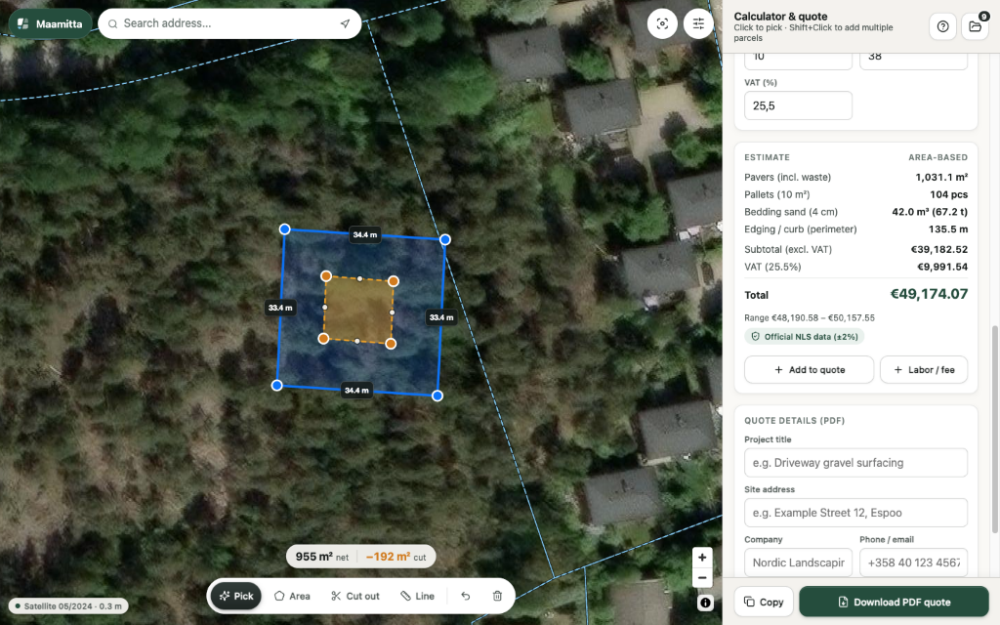
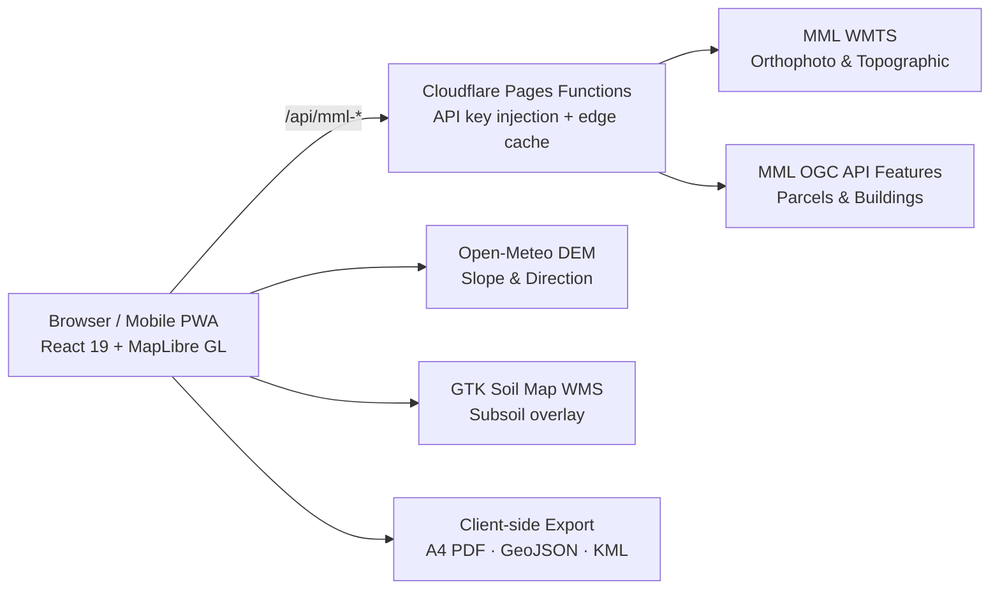
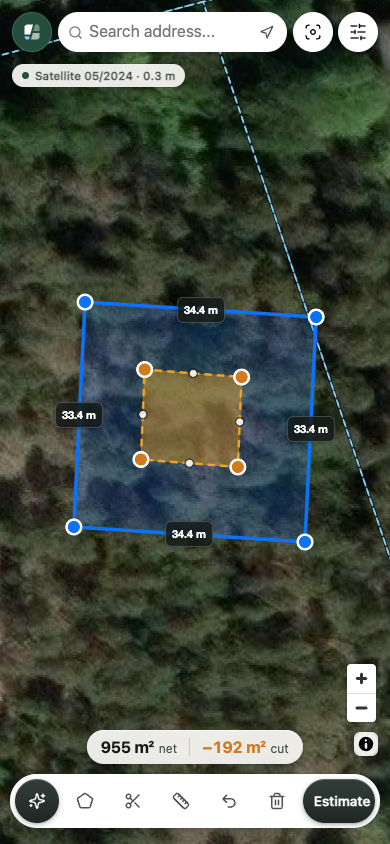

# Maamitta

Map measurement, material estimator, and A4 PDF quote generator for Finnish landscaping, earthworks, paving, fencing, and property maintenance contractors.

Pick an official Finnish property parcel from the National Land Survey (MML), subtract buildings automatically from the net area, calculate material quantities with 3D terrain slope correction and 25.5% VAT, and export a client-ready PDF or CAD/GIS file.



## How it works



- **Official Finnish cadastral data, zero exposed keys.** All Maanmittauslaitos (MML) tile, parcel, and building requests pass through a server-side proxy (`functions/api/[[route]].ts`) that injects `MML_API_KEY`, blocks path traversal, and caches `2xx` responses at the edge. Without an MML key, the app falls back to ESRI satellite imagery and OpenStreetMap.
- **Automatic building subtraction & snapping.** Clicking a parcel fetches both the official `PalstanSijaintitiedot` boundary and intersecting `maastotiedot/rakennus` footprints, clipping buildings out of the net area via `@turf/difference`. Manual drawing snaps to nearby visible parcel corners and edges.
- **Built for field work and colorblind accessibility.** All map geometry uses an Okabe-Ito-inspired palette (blue active area, amber dashed cutouts, violet lines, high-contrast cased cyan parcel boundaries) so every layer stays distinguishable with red-green colorblindness. Mobile views use `44×44 px` touch targets, `16 px` inputs (preventing iOS zoom), `100dvh` safe-area layout, and a crosshair point-placement mode.

<p align="center">
  
</p>

## Capabilities

| Area | What is included |
| :--- | :--- |
| **Measurement** | Auto-pick MML parcels (`Shift+Click` for multi-parcel quotes), freehand polygon & cutout drawing, draggable corners/midpoints, centerline-to-driveway corridor buffer (`1.2 m / 3.5 m / 4.0 m`), exact rectangle/circle quick shapes, and 3D terrain slope + compass direction detection |
| **Calculators** | Crushed stone / gravel, topsoil / mulch, stone paving (pavers, pallets, bedding sand, perimeter curbing), sod / lawn, asphalt paving, excavation / haulage (swell factor + truck loads), fencing (posts + running meters), forestry / field (hectares + seedlings), seasonal maintenance, plus custom labor/fee rows |
| **Map layers** | ESRI HD Satellite (with capture date & resolution badge), MML Orthophoto, MML Topographic / OSM, vector MML cadastral boundaries, GTK Finnish Soil Map WMS, and Finland maritime boundary mask |
| **Exports & sharing** | Client-side A4 PDF quote (offscreen map snapshot with baked edge lengths, optional company logo, itemized multi-zone breakdown, VAT), one-click WhatsApp/SMS text summary, plus GeoJSON and KML exports for CAD/GIS |
| **Bilingual & local** | Full Finnish (`fi`) and English (`en`) UI & PDF output, multi-project `localStorage` library (schema-validated on load), keyboard shortcuts (`P`, `A`, `V`, `L`, `X`, `⌘Z`, `Esc`), and cookie-free analytics hook (`src/analytics/track.ts`) |

## Local development

```bash
npm install
cp .env.example .env
npm run dev
```

To enable official Finnish MML orthophotos, cadastral parcels, and building footprints locally:

1. Create a free API key at [omatili.maanmittauslaitos.fi](https://omatili.maanmittauslaitos.fi/).
2. Add `MML_API_KEY=your-key` to `.env` (git-ignored; injected only by the Vite dev proxy).
3. Restart `npm run dev`.

## Scripts

```bash
npm run dev        # Vite dev server with local /api/mml-* proxy
npm run test       # Vitest unit tests (geometry, shapes, calculator, quotes, storage, export, analytics)
npm run typecheck  # Strict TypeScript check across src/, functions/, and vite.config.ts
npm run build      # Production build into dist/ with split vendor chunks
```

## Deployment (Cloudflare Pages)

Connect this repository to **Cloudflare Pages** with:

- **Build command:** `npm run build`
- **Build output directory:** `dist`
- **Environment variables:** `MML_API_KEY` (encrypted secret) and `MML_PROXY_ENABLED=true`

Cloudflare automatically serves `functions/api/[[route]].ts` for the MML proxy and `public/404.html` on unknown routes. See [docs/DEPLOYMENT.md](docs/DEPLOYMENT.md) for details.

## Documentation

- [docs/ARCHITECTURE.md](docs/ARCHITECTURE.md) — Module boundaries, proxy security, and multi-market extensibility
- [docs/DESIGN_SYSTEM.md](docs/DESIGN_SYSTEM.md) — Colorblind-safe tokens, tactile elevation, motion, and mobile-native rules
- [docs/DECISIONS_AND_ITERATIONS.md](docs/DECISIONS_AND_ITERATIONS.md) — Engineering and UX decisions from live testing
- [docs/DEPLOYMENT.md](docs/DEPLOYMENT.md) — Zero-cost Cloudflare Pages + edge caching setup
